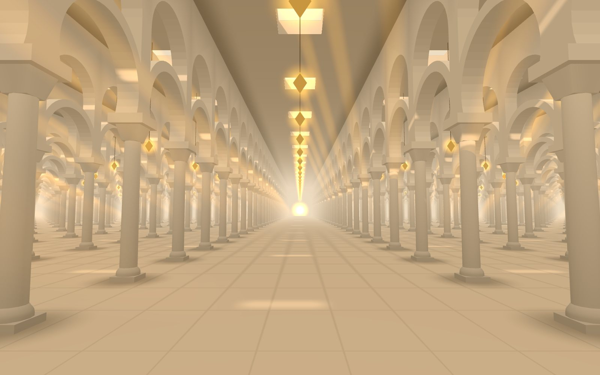
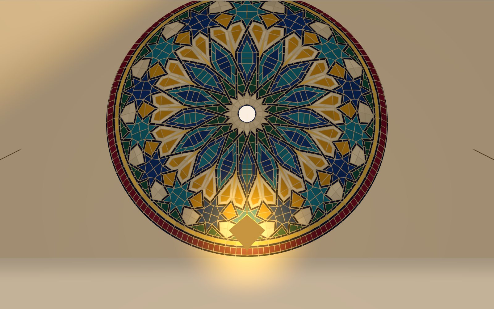
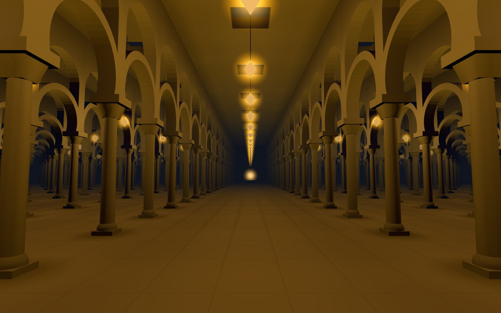

# Endless Rose

**Live: [jameel7007.github.io/endless-rose](https://jameel7007.github.io/endless-rose/)**



An endless prayer hall for dhikr. Each count carries you one bay down the nave of a T-plan
hypostyle, a forest of columns in the manner of Córdoba and Kairouan, toward the mihrab. After 33
counts you stand under the dome in front of it, and your gaze rises to a rose of glazed tile that
was laid while you walked. The next count takes you back to the start of the nave with the next
phrase, and a new rose.

The light is the real day where you are. The sun comes in through openings in the ceiling from where
it truly stands, because the nave faces the true qibla from your place. The hall keeps the five prayer
times, and lanterns take over at night.



## What's in it

- **An endless field of columns.** The hall is drawn bay by bay around you and shifted back as you
  walk (a floating origin), so it never ends and never grows. About 1,400 columns and arches are
  drawn with instancing in a few dozen draw calls.
- **Counting moves you.** A click, a tap, Space or Enter is one count. A critically damped spring turns
  counts into a glide: fast counting becomes one walk, slow counting becomes step, glide, rest. Each
  round of 33 is one phrase: SubhanAllah, Alhamdulillah, Allahu Akbar.
- **Light that keeps prayer time.** Prayer times and the sun's position are worked out in plain maths
  and checked against adhan-js: 178 of 192 reference times agree to the minute, the rest to one. Sun
  through the ceiling, the oculus's ellipse and the lanterns' light are computed in the shader from
  the hall's grid, with no shadow maps.
- **A new rose every round.** The roses are the three 16-fold medallions of
  [Rosette in Tesserae](https://github.com/Jameel7007/rosette), 2,000 to 3,000 cut tiles each, in six
  colourways (Fez, Alhambra, Isfahan, Córdoba, Night, Marrakech). Each day starts on a different one,
  and all 18 pairings come once in 18 rounds. Tiles are laid from the rim up to the crown as you walk,
  and the last is set as you arrive.
- **Quiet on any screen.** On slower devices the hall draws fewer pixels until frames run smoothly.
  With reduced motion, counts cut from bay to bay instead of gliding, and the gaze doesn't rise on its own.



## Using it

- **Count**: click, tap, or press Space or Enter.
- **Look around**: move the pointer (desktop), swipe (touch), or use the arrow keys.
- **Mihrab: Arrive / Ahead**: either each round of 33 walks you to the mihrab (the default), or the
  qibla wall stays on the horizon.
- **Light**: today's prayer times, a slider to preview any hour, and the calculation method and Asr
  reckoning. "Use my location" asks the device once and keeps the answer in this browser only.
  Without it, the times are for your time zone's main city. Add `?t=18:10` to the address to open
  at that hour.

## Running it

```bash
npm install
npm run dev
npm test
```

`npm run smoke` checks a cold load in headless Chrome using only real clicks, keys, taps and swipes.
`node scripts/views.mjs` takes screenshots of the key views. Both need the dev server on port 5197
(`npm run dev -- --port 5197`).

How it all works, in plain language: [docs/architecture.md](docs/architecture.md).

## Credits

The roses come from the author's [Rosette in Tesserae](https://github.com/Jameel7007/rosette)
(`scripts/import-roses.mjs`). The prayer-time maths follows PrayTimes.org's formulas, and the test
reference times were computed with [adhan-js](https://github.com/batoulapps/adhan-js).

MIT licence.
